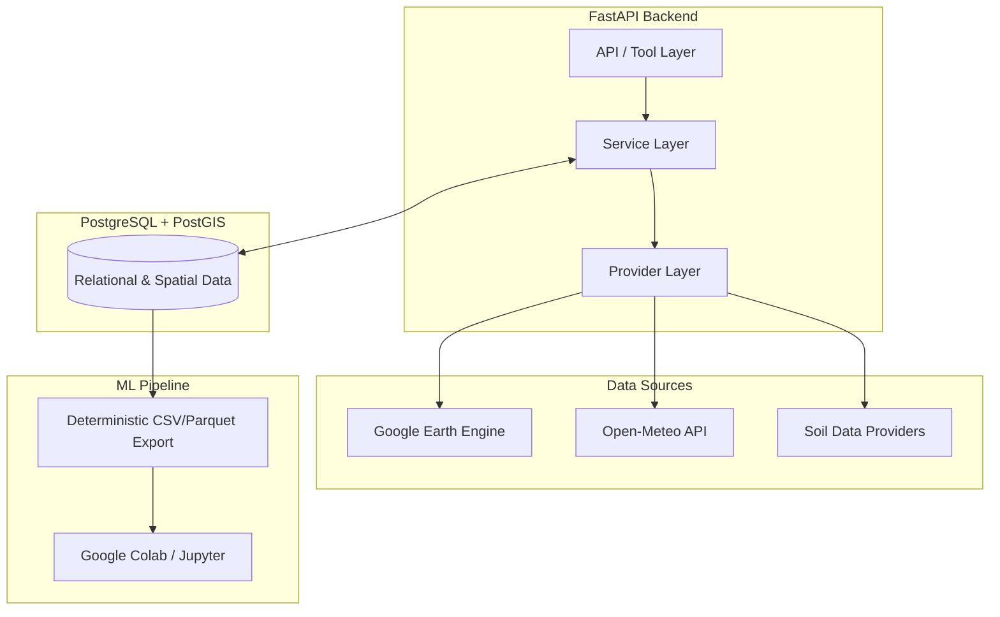

# BhoomiAI Architecture

BhoomiAI is an agricultural intelligence platform that merges geospatial satellite data, historical weather data, and machine learning to optimize farming strategies. 

## High-Level Architecture

The system is separated into a deterministic backend (Phase 0 infrastructure) and an isolated machine learning environment (Google Colab).

## Core Components

### 1. Persistence Layer
- **PostgreSQL**: The primary relational database.
- **PostGIS**: Geospatial extension to store farm and field boundaries natively.
- **SQLAlchemy 2.0**: The ORM used to map domain models to the database.
- **GeoAlchemy2**: Maps PostGIS geometry types directly into Python objects.
- **Alembic**: Manages database migrations safely, configured to ignore PostGIS system tables (`tiger`, `topology`).

### 2. Provider Layer
The provider layer encapsulates all external network calls, shielding the rest of the application from third-party API changes.
- **OpenMeteoProvider**: Fetches historical and forecasted weather variables (Temperature, Precipitation, ET0, Wind, Humidity) via REST.
- **GEEProvider**: Interfaces with the Google Earth Engine Python SDK to run cloud-masking and compute indices (NDVI, EVI) from Sentinel-2 surface reflectance datasets directly on Google's servers.

### 3. Service Layer
The service layer contains the core business logic. It invokes Providers, maps their diverse JSON responses into standard `NormalizedObservationDTO` objects, and handles database persistence.

### 4. Tool / Agent Layer
FastAPI endpoints and AI agent tools wrap the Service Layer. This boundary prevents large language models (like LangGraph agents) from executing direct network or database calls.

### 5. ML Export Boundary
To ensure data reproducibility and isolation, ML models are **never** trained directly against the live database. Instead, deterministic python scripts extract the data from PostgreSQL into `CSV/Parquet` files, which are then transferred to the training environments.
